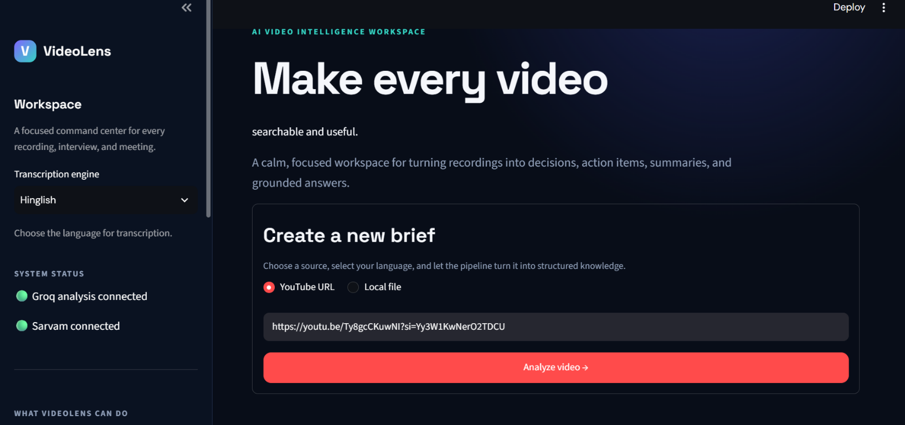
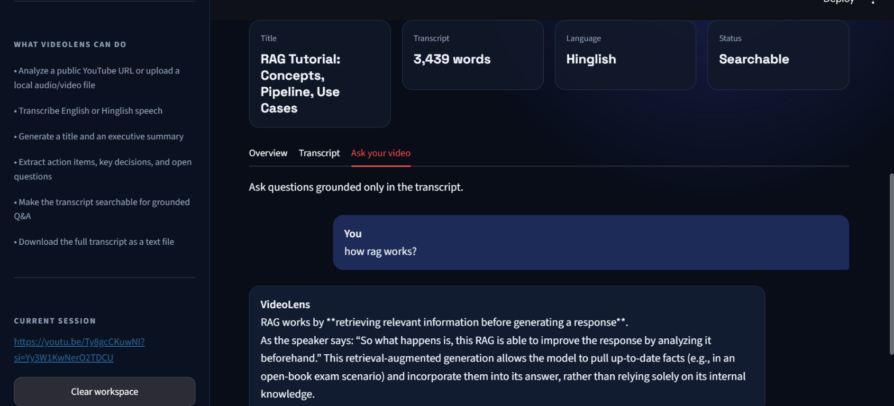

# VideoLens - A Video Intelligence Assistant

An end-to-end meeting and video intelligence pipeline that turns a YouTube URL or local media file into a searchable, structured knowledge base.

The system combines deterministic media processing with specialized AI services:

- YouTube/local media ingestion and audio normalization
- Local Whisper transcription for English audio
- Sarvam AI transcription for Hinglish and Indian-language workflows
- LLM-generated titles, summaries, action items, decisions, and open questions
- Retrieval-augmented question answering over the transcript
- Persistent Chroma vector storage for semantic search

## VideoLens in action

### Create a video intelligence brief



### Ask grounded questions about the video



## Why this project is interesting

This is designed as a production-minded pipeline rather than a single prompt wrapped around a video file. Each stage has a clear responsibility, explicit inputs and outputs, and a replaceable implementation:

```text
Video URL / local file
        │
        ▼
Audio ingestion + FFmpeg normalization
        │
        ▼
Chunked audio
        │
        ├── Whisper                    English transcription
        └── Sarvam AI                  Hinglish / Indic transcription
                    │
                    ▼
              Full transcript
                    │
        ┌───────────┼────────────┐
        ▼           ▼            ▼
     Summary     Extraction     Vector store
                 (actions,      (Chroma +
                 decisions,     embeddings)
                 questions)         │
                                    ▼
                              Transcript Q&A
```

## Core capabilities

### Multimodal ingestion

`utlis/audio_processors.py` accepts either a YouTube URL or a local media path. Audio is normalized to mono, 16 kHz WAV using the bundled FFmpeg binary provided by `imageio-ffmpeg`. This avoids requiring a machine-wide FFmpeg installation.

### Selectable transcription engines

`core/transcriber.py` exposes one transcription interface with two modes:

- `english`: local OpenAI Whisper inference
- `hinglish`: Sarvam AI speech-to-text translation, segmented into API-safe pieces

The engine choice is explicit, making cost, latency, language support, and privacy tradeoffs visible to the caller.

### Structured meeting intelligence

The transcript is analyzed into:

- a concise professional title
- a map-reduce summary for long transcripts
- action items with owners and deadlines when available
- key decisions
- unresolved questions and follow-ups

### Grounded transcript Q&A

The RAG layer splits the transcript, embeds the chunks with `all-MiniLM-L6-v2`, persists them in Chroma, and retrieves the most relevant context for each question. The assistant is instructed to stay within the transcript and explicitly say when the answer is unavailable.

## Project structure

```text
.
├── main.py                         # Interactive CLI entry point
├── app.py                          # Streamlit web interface
├── test.py                         # End-to-end example with a configured URL
├── sarvam_chat.py                  # Minimal Sarvam chat-completion smoke test
├── generate_transcript.py          # Sarvam STT transcript generation utility
├── core/
│   ├── transcriber.py              # Whisper/Sarvam routing
│   ├── summarizer.py               # Title and map-reduce summary generation
│   ├── extractor.py                # Actions, decisions, and questions
│   ├── vector_store.py             # Chroma persistence and embeddings
│   └── rag_engine.py               # Grounded transcript Q&A chain
├── utlis/
│   └── audio_processors.py         # Download, normalize, and chunk audio
├── Requirements.txt
├── downloads/                      # Generated media/audio artifacts
├── vector_db/                      # Generated Chroma persistence
└── transcripts/                    # Generated transcript files
```

## Setup

Python 3.10+ is recommended.

```powershell
git clone <repository-url>
cd VideoLens

python -m venv .venv
.\.venv\Scripts\Activate.ps1
python -m pip install -r Requirements.txt
```

Create `.env` in the project root:

```dotenv
SARVAM_API_KEY=your_sarvam_api_key
GROQ_API_KEY=your_groq_api_key
WHISPER_MODEL=small
GROQ_MODEL=openai/gpt-oss-20b
```

Never commit `.env` or print either API key. `.gitignore` already excludes `.env`.

## Run the full assistant

```powershell
python main.py
```

The CLI prompts for a YouTube URL or local file and a language mode:

```text
Language (english/hinglish): english
```

After processing, it prints the title, summary, action items, decisions, open questions, and starts an interactive transcript Q&A session. Type `exit` to leave the Q&A loop.

## Run the Streamlit interface

For the browser-based VideoLens dashboard:

```powershell
streamlit run app.py
```

The interface supports YouTube URLs and local audio/video uploads, selectable English or Hinglish transcription, downloadable transcripts, structured meeting insights, and grounded questions over the analyzed video.

## Run the end-to-end example

`test.py` is a repeatable demonstration script with a sample source URL:

```powershell
python test.py
```

Update `source` and `language` in the file before running it against another video.

## Run a standalone transcription

For a direct Whisper/Sarvam transcription of prepared WAV chunks:

```powershell
python -m core.transcriber --language english path\to\chunk_000.wav
python -m core.transcriber --language hinglish path\to\chunk_000.wav
```

For a longer Sarvam transcript, `generate_transcript.py` demonstrates chunking audio into 25-second segments and calling Sarvam’s speech-to-text API. Sarvam documents the synchronous endpoint as a short-audio API with a 30-second limit; longer recordings should use the Batch Speech-to-Text API.

## Sarvam smoke test

Once `SARVAM_API_KEY` is present:

```powershell
python sarvam_chat.py
```

This makes one chat-completion request with `sarvam-105b-conversations` and prints the reply. The official SDK and speech-to-text references are available at:

- <https://docs.sarvam.ai/api/getting-started/sdks>
- <https://docs.sarvam.ai/api/api-guides-tutorials/speech-to-text/overview>

## Configuration

| Variable           | Purpose                                                       | Default                                           |
| ------------------ | ------------------------------------------------------------- | ------------------------------------------------- |
| `SARVAM_API_KEY`   | Sarvam authentication                                         | Required for `hinglish` mode and Sarvam utilities |
| `SARVAM_STT_MODEL` | Legacy Sarvam translation model used by `core/transcriber.py` | `saaras:v2.5`                                     |
| `GROQ_API_KEY`     | Groq authentication for analysis and RAG                      | Required for summaries, extraction, and Q&A       |
| `GROQ_MODEL`       | Groq model used by analysis chains                            | `openai/gpt-oss-20b`                              |
| `WHISPER_MODEL`    | Local Whisper model size                                      | `small`                                           |

## Design decisions

### Local-first transcription where practical

English transcription defaults to Whisper, reducing API cost and keeping the basic path usable without sending English audio to a third party. Sarvam is available when Indic-language support or translation is required.

### Chunking before inference

Long audio is normalized and chunked before transcription. This bounds memory usage, keeps provider requests within their duration limits, and makes retries more manageable than treating an entire video as one request.

### Map-reduce summarization

Long transcripts are split into overlapping windows, summarized independently, and then combined. This avoids sending the entire transcript into one context window and gives the summarizer predictable input sizes.

### Grounded answers over free-form answers

RAG retrieval provides the LLM with only the most relevant transcript sections. The prompt explicitly forbids unsupported answers, which is important for meeting notes and interview-style knowledge extraction.

## Operational considerations

- First-run Whisper and embedding models may download large model artifacts.
- YouTube extraction depends on the availability of the upstream video and may emit JavaScript-runtime warnings from `yt-dlp`.
- Sarvam and Groq calls require valid API keys and incur provider-specific usage costs.
- Generated audio, transcripts, and vector data can be large; keep them out of source control unless they are intentional fixtures.
- For production deployment, add structured logging, retries with backoff, job-level checkpoints, persistent metadata, and automated tests around provider failures.

## Roadmap

- Replace hard-coded CLI sources with a typed configuration layer.
- Add provider-agnostic transcription interfaces and retryable job checkpoints.
- Add diarization and timestamp-aware transcript storage.
- Add automated evaluation for transcript quality, extraction precision, and RAG grounding.
- Expose the pipeline through a Streamlit or FastAPI interface with background jobs.
- Add CI checks for formatting, type checking, security scanning, and secret detection.

## License

Add the project’s intended license here before publishing the repository.
